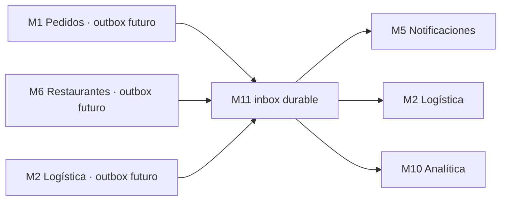

# Tala Eats Core v2 — M11 Integración: arquitectura aislada y puertas de staging

**Fecha:** 5 de noviembre de 2026.
**Rama:** `feat/core-v2-integracion-monolito-m11` (parent commit de `main`).
**PR:** integración aislada como nueva capa, no merge de PRs de módulos.
**Estado:** candidato LAB1; CI única en validación.
**Protección:** NO-GO LIVE, NO-GO despliegue Kali, NO-GO sustituir backend anterior.

## 1. Ensamblaje físico comprobable

Se creó un **commit de árbol Git**, cuyos padres contienen solo la rama `main`; el árbol contiene exactamente el HEAD de M1/M2 preservado desde la rama descendiente M2 y los ocho subárboles completos de M3–M10 por SHA. Se siguió la dependencia M2→M1 deliberadamente: el comparador GitHub declaró M2 `ahead_by=56` y `behind_by=0` respecto a M1 actual.

`source-lock.json` fija las diez rutas/SHAs. El gate verifica que los subárboles de dominio no se modifiquen accidentalmente durante integración. Los PR originales siguen en Draft y no se tocaron.

```text
Tala-Eats-NewBackend/
├── src/modules/orders/                M1, desde M2 descendiente M1
├── src/modules/logistics/             M2
├── modules/finance/                   M3
├── modules/users/                     M4
├── modules/notifications/             M5
├── modules/restaurants/               M6
├── modules/locations/                 M7
├── modules/payments/                  M8
├── modules/security/                  M9
├── modules/analytics/                 M10
└── modules/integration/               M11, nuevo
    ├── source-lock.json
    ├── migrations/001_integration_inbox.sql
    ├── src/admission.ts
    ├── src/events.ts
    ├── src/bridge.ts
    ├── src/scenario.ts
    ├── src/http-lab.ts
    ├── tests/
    └── scripts/
```

## 2. Una CI real de todos los módulos, sin producción

`.github/workflows/module11-integrated-ci.yml` ejecuta:

- Node.js 24 y PostgreSQL 16, **un mismo proceso de servidor PostgreSQL en Actions** con diez bases separadas: `tala_core_v2_test`, `tala_finance_v2_test`, `tala_users_v2_test`, `tala_notifications_v2_test`, `tala_restaurants_v2_test`, `tala_locations_v2_test`, `tala_payments_v2_test`, `tala_security_v2_test`, `tala_analytics_v2_test`, `tala_integration_v2_test`.
- Pinned Git subtree verification M1–M10.
- Instalación Node de raíz y ocho paquetes de dominio sin hooks, más M11.
- **Importación de entradas de código real de M1–M10 en el mismo runtime Node 24**, sin ejecutar mutaciones.
- Migraciones en el orden de cada dominio usando sus guardas originales.
- Ejecutar los tests/build reales de M1/M2 y de M3–M10, así como la batería M11.
- Pruebas adversariales M11 de 25 mensajes concurrentes, lease y late ACK, retries, DLQ, escenarios de 10 interfaces simuladas, seguridad del shell HTTP y rechazo SQL sobre base externa.

Esto constituye una **verificación combinada de código y entorno**, pero todavía no demuestra un pedido pagado y entregado a través de adaptadores reales.

## 3. Contrato de comunicación M11

Los módulos no leen SQL de otros dominios. M11 aporta únicamente un **puente de transporte en LAB**, no autoridad de negocio:



*Nota:* los conectores de outbox de origen y los adaptadores reales de consumidores son **pendientes**. En LAB M11 recibe eventos mediante una función de host confiable y los entrega a adaptadores inyectados de prueba. La fuente de verdad de los pedidos, estados, dinero e identidad permanece en los módulos titulares.

### Garantías del bridge

- Envelope cerrado con `schemaVersion`, UUID evento/comercio/pedido, origen, tipo y UTC; sin PII, tarjetas, montos, dirección, GPS ni credenciales.
- Tres temas mínimos y un mapa explícito de productores/consumidores. No se aceptan `payments.succeeded` ficticios, eventos de transferencia ni una ruta para emitir hechos financieros reales.
- Inserción transaccional del hecho y fanout a consumidores.
- `eventId` + hash del contenido para idempotencia ante reentregas; alteraciones del mismo ID se rechazan.
- Un registro por `(eventId,consumer)`, reclamación `SKIP LOCKED` y lease de 30 segundos para concurrencia.
- `claimId` por intento; un worker con lease vencido no puede ACKear el lease de otro.
- Tres intentos como máximo y estado `dead` como DLQ manual. El error de runtime **no se persiste en texto libre**.
- At-least-once, no exactly-once de efectos externos. Cada consumidor debe almacenar sus propias claves idempotentes.
- Métricas agregadas únicamente al host con `canMonitorIntegration`.

### Seguridad

`checkIntegrationAdmission` bloquea `NODE_ENV=production`, flags de escrituras, Stripe LIVE, payouts, HTTP público, URLs que no apunten a bases de laboratorio exactas y hosts de DB remotos. El shell M11 permite **solo dos GET de estado en loopback**. Los laboratorios de dominio no pasan automáticamente a ser endpoints públicos.

**La fuente de autoridad real todavía no está conectada**: M4 autenticaría identidad, M9 verificaría grants y autorización reforzada, M6 precio/stock/aceptación, M7 cobertura, M8 PSP TEST, M3 ledger, M2 entrega, M5 notificación, M10 KPI. Un mero import de código no valida esa secuencia.

## 4. Condiciones bloqueantes de un monolito modular realmente funcional

1. **Contratos/ports de implementación** M1–M10 con tipado compartido, sin importar subtablas ni exponer interfaces LAB en Internet.
2. **Auth gateway real** M4/M9 y autorización por recurso/rol, privilegios de staff, respaldo de sesiones y auditoría de seguridad.
3. **Pedidos y catálogo**: total congelado M1 igual a M6, capacidad real de M6 de aceptar/restar stock, zonas M7 validables, configuración de tarifas de M3.
4. **Stripe TEST real** conectado a una cuenta TEST con webhook nativo, PaymentIntent de M8, refund y conciliación M3. Nunca transformar `simulated_lab` en `FundsConfirmed.v1` real.
5. **Finanzas**: políticas de comisiones y tarifas consistentes, outbox con exact-once contable en consumidores, reconciliación de terceros, wallets y transferencia en HOLD hasta autorización.
6. **Logística**: asignación y presencia reales, PIN, entrega, reintentos, reserva de pedidos y efectivo.
7. **Workers de transporte** y control de backpressure, métricas de backlog/DLQ, firmas por productor, alertas/retención y recovery tras caídas.
8. **DB staging**: estrategia posterior para consolidar a una base con esquemas y permisos mínimos, sin quitar guardas LAB sin migraciones y backups. Hoy las diez DB están aisladas intencionalmente.
9. **Pruebas E2E de aplicaciones** Clientes→Restaurantes→Repartidores→Finanzas/ADMIN→Analítica. Un contrato simulado de diez interfaces solo verifica orden e invariantes, no tráfico comercial.
10. **Despliegue**: CI global, pruebas de estrés/seguridad, compatibilidad hacia atrás, backups/restore, rollback, canary y aprobación explícita antes de tocar Kali.

## Decisión

- **GO LAB1** si la CI integrada demuestra árboles pinneados, imports reales, build/tests de diez dominios, bridge M11 y SQL con guardas en un mismo ambiente descartable.
- **NO-GO para declarar comercialmente integrado:** no hay wiring real de las diez funciones en un único servidor Express, ni pagos Stripe TEST reales, ni E2E de las tres apps.
- **NO-GO para LIVE / merge / Kali:** mantener PR M11 Draft y los diez PR originales sin fusionar.

[M11 README](../modules/integration/README.md).
